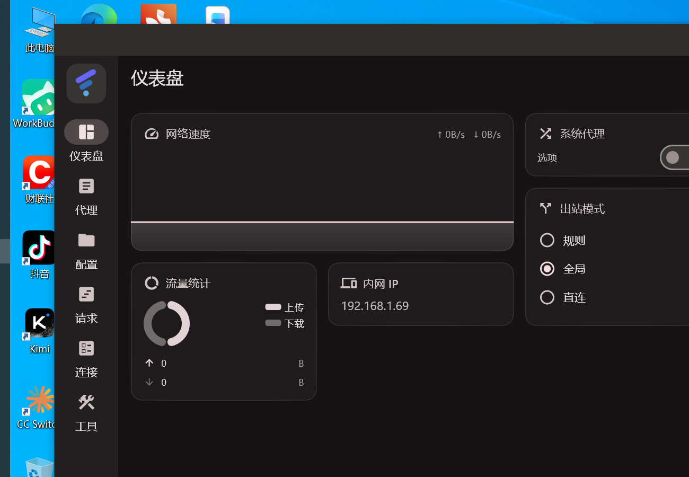

# FlClash 订阅配置指南（配好后 TradingView 才能用）

> 适用：本机已装的 FlClash（`C:\Program Files\FlClash\`）。
> 目的：导入机场订阅 → 开系统代理 → TradingView 客户端/网页版可用。
> 全程约 3 分钟。订阅链接是你的私有凭据，**不要发给任何人（包括我）**。

## 你的 FlClash 当前状态（2026-11-22 实测截图）

- 左侧导航：**仪表盘 / 代理 / 配置 / 请求 / 连接 / 工具**
- 现在「流量统计」全是 0 —— 因为还没导入任何订阅（配置是空的）
- 注意右上「出站模式」当前是 **全局** —— 配好后要改回 **规则**（原因见第 4 步）

---

## 第 1 步 · 拿到订阅链接（在机场后台，不在 FlClash 里）

1. 用浏览器登录你买机场的官网后台；
2. 找「**一键订阅** / 订阅地址 / 复制订阅」之类的按钮；
3. 类型选 **Clash / Clash Meta / Clash Verge**（这几种是同一个格式，FlClash 都认），点复制；
4. 链接长这样：`https://你的机场域名/api/v1/client/subscribe?token=xxxxxxxx`

> ⚠️ 如果机场只给「Clash for Windows」的链接也没关系，直接复制，FlClash 内核是 Clash Meta，兼容。

## 第 2 步 · 把订阅导入 FlClash

1. 打开 FlClash（我已帮你启动，任务栏/托盘有图标）；
2. 点左侧导航的「**配置**」（文件夹图标）；
3. 点页面右上角的「**＋**」（新建配置）；
4. 选「**从 URL 导入 / 链接导入**」；
5. 把第 1 步复制的链接**粘贴**进输入框 → 点「确定 / 保存」；
6. 等几秒，列表里出现一张新的配置卡片（名字一般是机场名）；
7. **点一下这张卡片**让它高亮 —— 这步是「启用该配置」，很多人漏掉这步导致不生效。

> 如果导入报错「下载失败 / 解析失败」：先检查链接有没有复制完整（必须 `https://` 开头）；还是失败就在导入窗口把「通过代理更新」开关**关掉**再试（首次导入本来就没有代理可用）。

## 第 3 步 · 选一个节点

1. 点左侧「**代理**」；
2. 顶部是策略组（常见名字：🚀 节点选择 / PROXY / 自动选择），点它展开国家/地区列表；
3. 点右上「⚡」**测速**，选延迟绿色、数值低的节点（香港/日本/新加坡/美国都行，看 TradingView 哪个都快）；
4. 不确定就选「自动选择 / URL-TEST」组，让它自己挑。

## 第 4 步 · 开系统代理（关键设置，别抄错）

回到左侧「**仪表盘**」，看右侧两块：

1. **出站模式：选「规则」** ←←← 重点！
   - 规则 = 只有国外网站走代理，国内直连；
   - ❌ **不要用「全局」**：全局会让同花顺、掘金终端、券商交易软件、飞书全部绕道国外服务器，轻则掉线重则交易软件登录异常；
   - 「直连」= 代理全关。
2. **系统代理：打开开关**（右上角那个灰色拨钮，点成亮色）。

做完这两步，Windows 全局代理就生效了（等价于系统设置里代理指向 127.0.0.1）。

## 第 5 步 · 验证

打开浏览器访问：`https://cn.tradingview.com/`

- 能正常打开、图表能加载 → 配置成功 ✅
- 然后去微软商店把 TradingView 客户端装上（页面我已帮你打开），登录账号即可，图表数据走的也是这条代理。

---

## 出问题按这个顺序查

| 现象 | 原因与处理 |
|---|---|
| 导入订阅报错 | 链接没复制全；关闭「通过代理更新」重试；链接过期 → 去机场后台重新复制 |
| 节点全部超时（测速全红） | 订阅本身失效/机场跑路；或本地 DNS 污染 → 换几个节点再测，全红就是订阅的问题 |
| 浏览器还是打不开 TradingView | ① 系统代理开关没开；② 出站模式选了「直连」；③ 配置卡片没点选启用；④ 节点超时 → 换节点 |
| 同花顺/掘金掉线、委托失败 | **出站模式被设成了「全局」** → 立刻改回「规则」 |
| TradingView 客户端白屏 | 客户端走的也是系统代理 → 确认浏览器能开网页版，网页版通则客户端通 |

## 日常使用建议

- **交易时段**：建议保持「规则」模式常开，不影响任何国内交易软件；
- **不用 TradingView 时**：可以把「系统代理」关掉（FlClash 挂后台不碍事），要用时再开；
- **订阅流量**：TradingView 图表是 websocket 长连接，流量不大，但自动刷新一整天也会跑几百 MB，留意套餐余量；
- **重启电脑后**：FlClash 不会自动开系统代理（除非你勾了开机自启），用之前开一下即可。
