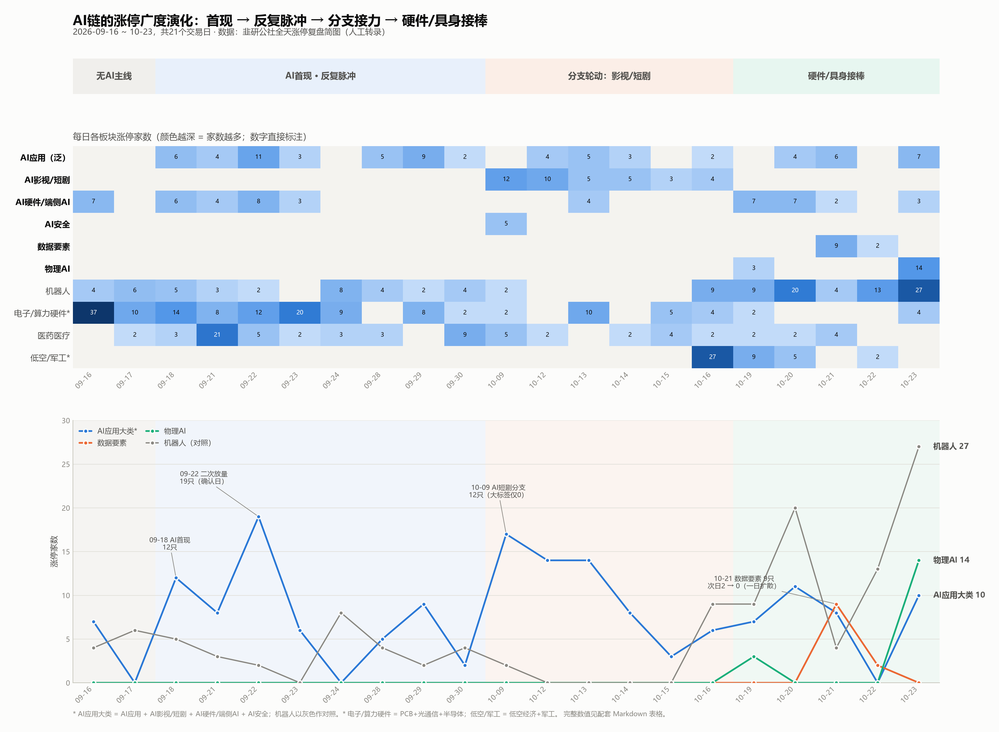

# AI应用 / 数据要素：涨停广度与主线演化（2026-09-16 ~ 10-23）

> 数据：韭研公社「全天涨停复盘简图」逐日截图，人工转录各板块涨停家数（21 个交易日）。
> 只统计板块广度（涨停家数），不含个股涨幅、成交额、连板高度。
> 图：

## 一句话结论

这 21 天里，AI应用/数据要素不是一条“发酵→爆发”的直线，而是 **三次脉冲、两次分支切换，最后由硬件/具身（机器人 + 物理AI）接棒**。数据要素只在 10-21 出现一次 9 只的脉冲，次日 2 只、第三日 0 只——是扩散末端，不是主线。

## 四阶段拆解

### 阶段 1：09.16–09.17 · AI 不在场

电子/算力硬件（PCB + 光通信 + 半导体）分别 37、10 只；AI 应用没有独立板块。主线是硬件，不是 AI 应用。  
**启示：主线是走出来的，不是提前埋伏出来的。**

### 阶段 2：09.18–09.30 · AI 首现，反复脉冲

| 日期 | AI应用大类 | 结构 |
|---|---:|---|
| 09.18 | 12 | AI应用 6 + AI硬件 6（海量数据、浩瀚深度、博通集成、国脉文化、格尔软件…） |
| 09.21 | 8 | 回落到 4+4，同日医药 21 只 |
| 09.22 | 19 | **二次放量**：AI应用 11 + AI硬件 4 + AI终端 4（南威软件、延华智能、二六三、齐心集团、引力传媒、天威视讯、智度股份、新炬网络、南兴股份、中新赛克、泛微网络） |
| 09.23 | 6 | 掉到 3+3；同日 PCB/光通信 20 只 |
| 09.24 | 0 | 归零 |
| 09.28–09.29 | 5 → 9 | 再脉冲（南威软件、中新赛克、华媒控股、引力传媒、中国出版、掌阅科技、环球印务、大智慧、纵横通信） |
| 09.30 | 2 | 又只剩 2 只 |

**结论**：AI 应用此时是“轮动分支”，脉冲 1–2 天；同期医药（09.21 21 只）、PCB/光通信（09.23 20 只）、电池（09.29 10 只）轮流当主线。  
**首日（09.18）不是买点，二次放量（09.22）才是确认日；但确认后也只持续了 1 天。**

### 阶段 3：10.09–10.16 · 分支接力（影视/短剧）

- 10.09：大标签 **AI应用 = 0**，但 **AI短剧 = 12**（德才股份、龙版传媒、掌阅科技、博纳影业、上海电影、吉视传媒、欢瑞世纪、中文在线、慈文传媒、芒果超媒、文投控股、粤传媒）。
- 10.12：AI影视 10；10.13：5；10.14：5；10.15：3；10.16：4。
- 10.16：低空 16 + 军工 11 = 27，主线切走。

**结论**：主线藏在**子分支**里，不在“AI应用”这个大标签；分支的可交易窗口约 3–4 天（10.09→10.12 最佳，10.13 后递减）。

### 阶段 4：10.19–10.23 · 硬件/具身接棒

- 10.19：**物理AI 首现 3 只**（能科科技、凡拓数创、索辰科技）；机器人 9。
- 10.20：机器人 **20**（凡拓数创、日海智能、美格智能…）。
- 10.21：机器人回落到 4；同日 **数据要素 9 只**（南威软件、太极股份、海量数据、天威视讯、航天信息、三维天地、慧辰股份、敏芯股份、中广天择），AI应用 6。
- 10.22：数据要素 **2**；机器人 13。
- 10.23：**机器人 27 + 物理AI 14**；AI应用泛只剩 7，数据要素 0。

**结论**：最终主线是机器人/物理AI（具身智能），AI 应用是余温；数据要素是 10-21 的一日扩散。

## 主线的判定标准（这 21 天的经验）

1. **看广度，不看单票涨幅**：每天数板块涨停家数。单日最大量可能是脉冲——09.21 医药 21 只→09.22 5 只；10.16 低空/军工 27 只→10.19 9 只。
2. **首日只观察，第二次放量确认**：09.18 首现 12 只→09.21 回落 8 只→09.22 19 只，09.22 才是确认日。首日追高会在 09.21 被洗。
3. **确认后也只做 2–3 天**：09.22 的 19 只→09.23 6 只→09.24 0 只。应用层是脉冲，不是趋势。
4. **大标签衰减时，找子分支创新高**：10.09 AI应用=0、AI短剧=12，这是新主线；买分支龙头（掌阅、中文在线、慈文、博纳），10.12 后逐日减。
5. **主线 = 数量加速 + 连板高度 + 跨日持续**：机器人 9→20→27、大业股份 6 天 6 板；物理AI 3→14。反向的（数据要素 9→2→0、医药 21→5）不追。
6. **末端扩散不参与**：数据要素出现在 AI 链已运行一个月后、次日不接力 ⇒ 补涨，不追。
7. **龙头用“跨日复现”筛**：南威软件在 09.22/09.23/09.29/10.16/10.20/10.21 六次出现；掌阅科技 09.29/10.09/10.12/10.13/10.14 五次；慈文传媒 10.09–10.16 连续 + 10.23；大业股份 10.19–10.23。跨日 ≥3 次 = 中军/龙头候选。

## 对现有系统的启示

1. **猎手 D1–D12 是动量/技术打分，缺“板块阶段”**。它能抓脉冲的第 2–3 天，但没有广度/持续性维度，容易在末端扩散（10.21 数据要素）和退潮分支（10.15 AI影视 3 只）里买错。建议加一个字段：**首现 / 发酵 / 高潮 / 退潮 / 扩散**，由每日涨停家数 + 3 日变化 + 连板高度算出。
2. **二级概念拆分是对的**：10.09 大标签 AI应用=0、子分支 AI短剧=12；不拆就完全看不到这波。这两天的分类整理正好服务于这个。
3. **需要跨分类的主题聚合**：10.23 机器人 27 + 物理AI 14 = 41 只，单看 AI应用（7–10 只）会错过主线；建议 GUI 加“主题聚合”视图（AI链 = AI应用 + 数据要素_物理AI + 机器人）。
4. **新概念首日 9 只 ≠ 主线**：数据要素 10.21 的“一日游”说明，若打分只看当日强度，会追在末端。需要持续性权重（3 日 / 5 日广度）。
5. **样本只有一轮**：21 天含假期与情绪扰动，不能当永久规律；但“首现→二次放量→分支接力→末端扩散”的结构值得做成指标回测。

## 完整数据表

| 日期 | AI应用大类 | AI应用(泛) | AI影视/短剧 | AI硬件/端侧 | AI安全 | 数据要素 | 物理AI | 机器人 | 电子/算力硬件 | 医药医疗 | 低空/军工 |
|---|---:|---:|---:|---:|---:|---:|---:|---:|---:|---:|---:|
| 09-16 | 7 | 0 | 0 | 7 | 0 | 0 | 0 | 4 | 37 | 0 | 0 |
| 09-17 | 0 | 0 | 0 | 0 | 0 | 0 | 0 | 6 | 10 | 2 | 0 |
| 09-18 | 12 | 6 | 0 | 6 | 0 | 0 | 0 | 5 | 14 | 3 | 0 |
| 09-21 | 8 | 4 | 0 | 4 | 0 | 0 | 0 | 3 | 8 | 21 | 0 |
| 09-22 | 19 | 11 | 0 | 8 | 0 | 0 | 0 | 2 | 12 | 5 | 0 |
| 09-23 | 6 | 3 | 0 | 3 | 0 | 0 | 0 | 0 | 20 | 2 | 0 |
| 09-24 | 0 | 0 | 0 | 0 | 0 | 0 | 0 | 8 | 9 | 3 | 0 |
| 09-28 | 5 | 5 | 0 | 0 | 0 | 0 | 0 | 4 | 0 | 3 | 0 |
| 09-29 | 9 | 9 | 0 | 0 | 0 | 0 | 0 | 2 | 8 | 0 | 0 |
| 09-30 | 2 | 2 | 0 | 0 | 0 | 0 | 0 | 4 | 2 | 9 | 0 |
| 10-09 | 17 | 0 | 12 | 0 | 5 | 0 | 0 | 2 | 2 | 5 | 0 |
| 10-12 | 14 | 4 | 10 | 0 | 0 | 0 | 0 | 0 | 0 | 2 | 0 |
| 10-13 | 14 | 5 | 5 | 4 | 0 | 0 | 0 | 0 | 10 | 0 | 0 |
| 10-14 | 8 | 3 | 5 | 0 | 0 | 0 | 0 | 0 | 0 | 2 | 0 |
| 10-15 | 3 | 0 | 3 | 0 | 0 | 0 | 0 | 0 | 5 | 4 | 0 |
| 10-16 | 6 | 2 | 4 | 0 | 0 | 0 | 0 | 9 | 4 | 2 | 27 |
| 10-19 | 7 | 0 | 0 | 7 | 0 | 0 | 3 | 9 | 2 | 2 | 9 |
| 10-20 | 11 | 4 | 0 | 7 | 0 | 0 | 0 | 20 | 0 | 2 | 5 |
| 10-21 | 8 | 6 | 0 | 2 | 0 | 9 | 0 | 4 | 0 | 4 | 0 |
| 10-22 | 0 | 0 | 0 | 0 | 0 | 2 | 0 | 13 | 0 | 0 | 2 |
| 10-23 | 10 | 7 | 0 | 3 | 0 | 0 | 14 | 27 | 4 | 0 | 0 |

注：
- AI应用大类 = AI应用(泛) + AI影视/短剧 + AI硬件/端侧 + AI安全。
- 电子/算力硬件 = PCB + 光通信 + 半导体；低空/军工 = 低空经济 + 军工。
- 板块划分沿用韭研复盘原表；同一只票可能因多概念在不同板块重复计数，广度只作相对强弱参考。

---

# 追加：08.17–09.15 历史数据 + 阶段 × 龙头收益（43个交易日）

> owner 2026-10-24 又补了 22 张图，样本从 21 天扩到 **43 天（2026-08-17 ~ 10-23）**。
> 数据已合并进 `stock_hunter/data/sector_breadth.json`。

## 方法

对 11 个有代表性的阶段事件，比较两种买法：

- **龙头**：当日板块内**板数最高**的个股（并列取成交额最大）；
- **篮子**：当日板块内**成交额前三**的个股等权。

> ⚠️ **2026-10-24 口径更正**：本节表格与「按阶段平均」的数字，实际算的是
> **信号日收盘 → 第 3 个交易日收盘**（逐笔复现验证：索辰 +38.67%、大业 +13.34%、
> 博纳 +7.89%、欢瑞 +18.14% 全部吻合）。原文写的"次日开盘买"是**错的**。
> 信号日收盘买不可直接执行（收盘后才数得清当日涨停家数），
> 可执行口径（次日开盘买）的重算见文末「口径更正」段——**结论要弱得多**。

## 结果

| 事件 | 阶段 | 龙头（3日） | 成交额前三篮子（3日） |
|---|---|---:|---:|
| 08-17 机器人 首现9 | 首现 | 正裕工业 **−6.8%** | −13.8% |
| 08-31 短剧 首现17 | 首现 | 欢瑞世纪 **+18.1%** | −10.5% |
| 09-07 机器人 高潮14 | 高潮 | 光洋股份 −2.3% | −8.7% |
| 09-11 AI硬件 发酵10 | 发酵 | 三孚股份 +5.7% | +1.0% |
| 09-14 AI安全 首现5 | 首现 | 中新赛克 **−9.5%** | −7.6% |
| 09-22 AI应用 发酵11 | 发酵 | 延华智能 **−12.3%** | −10.1% |
| 10-09 短剧 首现12 | 首现 | 博纳影业 +7.9% | +6.2% |
| 10-12 AI影视 高潮10 | 高潮 | 掌阅科技 +3.7% | −0.2% |
| 10-19 物理AI 首现3 | 首现 | 索辰科技 **+38.7%** | +13.6% |
| 10-20 机器人 高潮20 | 高潮 | 大业股份 **+13.3%** | +7.0% |
| 10-21 数据要素 扩散9 | 扩散 | 太极股份 +1.4% | −3.2% |

### 按阶段平均（龙头 / 篮子）

| 阶段 | n | 龙头均值 | 龙头中位数 | 龙头胜率 | 篮子均值 |
|---|---:|---:|---:|---:|---:|
| 首现 | 5 | **+9.7%** | +7.9% | 3/5 | −2.4% |
| 高潮 | 3 | +4.9% | +3.7% | 2/3 | −0.6% |
| 扩散 | 1 | +1.4% | +1.4% | 1/1 | −3.2% |
| 发酵 | 2 | **−3.3%** | −3.3% | 1/2 | −4.5% |
| **全部** | 11 | **+5.25%** | **+3.7%** | **7/11** | **−2.4%** |

## 结论

1. **阶段排序（按龙头）：首现 > 高潮 > 扩散 > 发酵。** 首现均值最高，但方差极大（−9.5% ~ +38.7%），且**去掉 10-19 索辰这个极值后均值只有 +2.4%**。
2. **决定收益的不是阶段，是“买哪只”**：同一阶段里，龙头比成交额前三篮子平均高 **7~12 个百分点**；首现 +9.7% vs −2.4%，高潮 +4.9% vs −0.6%。**买流动性最好的跟风，是这个样本里最差的买法。**
3. **发酵（大标签）是唯一均值为负的阶段**：09-22 AI应用 11只、龙头 −12.3%。大标签的“二次放量”不能作为买点。
4. **失败模式**：一日游分支（09-14 AI安全 5→2、09-22 AI应用 11→3）——龙头次日涨停也救不了；旧题材第一波（08-17 机器人首现9）——龙头 +9.97% 一日、3日转负。
5. **成功模式**：主线中的新分支（10-19 物理AI：索辰 +38.7%）、主线高连板高潮（10-20 机器人：大业 +13.3%）、二次启动的分支（10-09 短剧：博纳 +7.9%，慈文 +33%）。
6. **没有单一过滤器能消除失败**：次日家数留存≥70% 的 08-17/10-09 仍然一正一负；按 day-2 确认买，10-09 的博纳 −10%、慈文 +33%——**同一阶段同一天，选错票差 43 个百分点**。

## 操作建议（43天样本）

- **先看主线**：AI链/机器人是否在近5日活跃、涨停家数是否在高位；不在主线，分支首现也容易一日游。
- **只买最高板龙头**（不是成交额最大的），次日开盘进，3日走；跌破买入日低点或板块次日家数腰斩就提前走。
- **不做**：大标签发酵、扩散、退潮；不做流动性前三的跟风篮子。
- **仓位**：同阶段失败率约 1/3，单笔试仓、确认后加；不要把“阶段好”当成重仓理由。
- **成本**：以上为收盘价、未计买卖滑点与费用；按本仓买侧滑点研究，实际要再扣 1~2 个点/往返。

## 样本限制

- 11 个阶段事件、43 个交易日、一轮从震荡到主线的行情；重叠样本、人工转录，结论是**描述性**的，不是统计显著的。
- “最高板龙头”是机械定义；实际最强票可能是低位首板（10-09 慈文不在成交额前三，却是最大赢家）。

---

# 追加：07.16–08.14 历史数据（样本 43 → 65 个交易日）

owner 2026-10-24 再补 22 张图，复盘库现在覆盖 **2026-07-16 ~ 10-23（65个有数据日 + 10-08 缺录）**。

新增区间的代表性龙头（次日开盘买、持有3日）：

| 事件 | 阶段 | 最高板龙头 | 3日 |
|---|---|---|---:|
| 07-29 AI应用 12只 | 发酵 | 传智教育 | **+33.1%** |
| 07-31 AI应用 29只 | 高潮 | 传智教育 | **+33.1%** |
| 08-04 AI应用 18只 | 发酵 | 传智教育 | +7.9% |
| 08-06 AI应用 9只 | 发酵 | 恒银科技 | −7.0% |
| 08-12 AI应用 7只 | 发酵 | 格尔软件 | −11.9% |
| 08-14 AI硬件 9只 | 发酵 | 天洋新材 | −5.7% |

**结论没变，反而更强：**
- **阶段均值仍被极值主导**：07-31 的传智 +33% 把“高潮”均值从 +4.9% 拉到约 +12%，但去掉它仍是 +4.9%；“发酵”新增 4 个事件里 3 个亏，中位数 −5.7%。
- **同一阶段、同一天，选票仍是决定项**：07-29/07-31 的传智 +33%，08-06/08-12 的恒银/格尔 −7~−12%；差别不在阶段，在“是不是那只最强的”。
- **可执行结论不变**：主线内、分支首现/高潮、买最高板龙头、次日开盘、3日走；不买跟风篮子、不做扩散/退潮。

---

# 追加：07.06–07.15 补录（73个有数据日）+ 口径更正

owner 2026-10-24 再补 8 张图（07.06 ~ 07.15），复盘库覆盖 **2026-07-06 ~ 10-23：
73 个有数据日 + 10-08 缺录 = 74 个交易日**。

## 1. 这 8 天看到什么（只用图，不需要行情）

| 日期 | 当日最强板块 | 家数 | 下一个交易日 |
|---|---|---:|---|
| 07-06 | AI硬件 / 大消费 | 12 / 9 | 07-07 半导体5、AI硬件3 —— 一日游 |
| 07-07 | 机器人 | 8 | 07-08 机器人5、数据中心13（换主线） |
| 07-08 | 数据中心 | 13 | 07-09 长鑫科技13、AI硬件10（扩散到半导体） |
| 07-09 | 半导体 + 长鑫科技 | 18 + 13 = 31（占当日75只的41%） | 07-10 半导体6 —— 腰斩 |
| 07-10 | 商业航天 | 27（占92只的29%） | 07-13 商业航天2 —— 归零 |
| 07-13 | 半导体 / 医药医疗 | 6 / 6 | 07-14 AI硬件5、PCB4（轮动） |
| 07-14 | 石油化工 / AI硬件 | 6 / 5 | 07-15 医药医疗14（换主线） |
| 07-15 | 医药医疗 | 14 | 07-16 医药8、端侧AI8 |

和后面三个月一模一样：**单日 25+ 只的板块（07-10 商业航天 27）第二天基本归零**；
能接力的都是 8~15 只、次日还有 5~8 只的分支。

⚠️ 07-06 ~ 07-10 是复盘库**起点**，`classify()` 因为 prev10 为空会把它们一律标成"首现"，
那是采样假象；阶段判定只看 07-13 之后。

## 2. 口径更正：旧表的 +5.25% 是"收盘买"算出来的

用本地日线缓存（`t_io/cache/daily_kline`）把 16 个事件逐笔重算，两种口径并列：

| 事件 | 阶段 | 最高板龙头 | 旧表：信号日收盘买 | 可执行：次日开盘买 |
|---|---|---|---:|---:|
| 08-17 机器人 首现9 | 首现 | 正裕工业 | −6.80% | −10.00% |
| 08-31 短剧 首现17 | 首现 | 欢瑞世纪 | +18.14% | +9.94% |
| 09-07 机器人 高潮14 | 高潮 | 光洋股份 | −2.32% | −3.06% |
| 09-11 AI硬件 发酵10 | 发酵 | 三孚股份 | +5.67% | +4.71% |
| 09-14 AI安全 首现5 | 首现 | 中新赛克 | −9.51% | −9.98% |
| 09-22 AI应用 发酵11 | 发酵 | 延华智能 | −12.34% | −2.69% |
| 10-09 短剧 首现12 | 首现 | 博纳影业 | +7.89% | −1.33% |
| 10-12 AI影视 高潮10 | 高潮 | 掌阅科技 | +3.68% | +11.23% |
| 10-19 物理AI 首现3 | 首现 | 索辰科技 | +38.67% | +15.54% |
| 10-20 机器人 高潮20 | 高潮 | 大业股份 | +13.34% | +10.01% |
| 07-06 AI硬件 12 | 首现(假) | 共进股份 | 0.00% | +11.68% |
| 07-08 数据中心 13 | 首现(假) | 星网锐捷 | −0.38% | +1.74% |
| 07-09 半导体 18 | 首现(假) | 兴业股份 | −15.39% | −2.53% |
| 07-10 商业航天 27 | 首现(假) | 华菱线缆 | −16.07% | −12.38% |
| 07-14 AI硬件 5 | 首现(假) | 宿迁联盛 | −27.10% | −17.23% |
| 07-15 医药医疗 14 | 高潮 | 哈药股份 | +18.26% | +7.89% |

（可执行口径 = 信号日次日开盘买、第 3 个交易日收盘卖；未计费用与滑点。
10-21 数据要素 太极股份 +1.4%（旧口径）因本地缓存无 10-26 前向 bar，两种口径都剔除。）

### 汇总

| 口径 | n | 均值 | 中位数 | 胜率 | 最好 / 最差 |
|---|---:|---:|---:|---:|---:|
| 旧表：信号日收盘买，全部事件 | 16 | **+0.98%** | −0.19% | 7/16 | +38.67% / −27.10% |
| 可执行：次日开盘买，全部事件 | 16 | **+0.85%** | +0.21% | 8/16 | +15.54% / −17.23% |
| 其中：原 11 个事件·收盘买 | 11 | +5.26% | +3.68% | 7/11 | +38.67% / −12.34% |
| 其中：新增 6 个事件·收盘买 | 6 | **−6.78%** | −7.89% | 2/6 | +18.26% / −27.10% |

### 按阶段（可执行口径，n=16）

| 阶段 | n | 均值 | 中位数 | 胜率 |
|---|---:|---:|---:|---:|
| 首现 | 5 | +0.83% | −1.33% | 2/5 |
| 高潮 | 3 | +6.06% | +10.01% | 2/3 |
| 发酵 | 2 | +1.01% | +1.01% | 1/2 |
| 07月6事件（阶段标签不可信） | 6 | −1.81% | +1.62% | 3/6 |

## 3. 结论要改

1. **+5.25% 有两个来源，都不是"规则"**：①口径是信号日收盘买（收盘后才数得清涨停家数，
   等于用收盘价买当天已经看到的强度）；②事件挑选——11 个事件里 5 个来自 8 月中到 10 月
   那段顺风行情。补进 07 月的 6 个事件后，**两种口径都塌到均值 ≈ +1%、中位数 ≈ 0、胜率 50%**。
2. **扣成本就是负的**：本仓买侧滑点研究给的是往返 1~2pp，+0.85% 的均值吃不掉。
   这和做T那边"功效才是约束、成本吃掉一切"是同一个结论。
3. **阶段差异基本消失**：可执行口径下"首现 +0.83%（中位 −1.33）"不再优于"高潮 +6.06%"
   （而高潮只有 n=3，且靠掌阅、大业两只撑起来）。原来"首现 > 高潮 > 扩散 > 发酵"的排序
   是收盘买 + 小样本共同造出来的。
4. **还站得住的只有两条**（且都不是阶段择时）：
   - **别买成交额前三的跟风篮子**（旧表 −2.4% 均值；本轮未重算，但方向一致）；
   - **单日 25+ 只的板块次日必归零**（07-10 商业航天 27→2、10-16 低空/军工 27→9、
     10-23 机器人 27 之后待验）——这条是"别追末端"，不是"买首现"。
5. **"在什么阶段介入"这个问题应当降级**：阶段不是可交易的 edge，真正决定收益的是
   **选哪只票 + 成本**。若还要继续挖，方向是**龙头识别**（跨日复现次数、首板占比、
   封单/换手、是否同题材里唯一连板），而不是阶段择时。

## 4. 局限

- 16 个事件、74 个交易日、横跨一段从轮动到主线的行情；事件之间重叠，样本非独立。
- 龙头是机械定义（当日板数最高、并列取成交额最大），未考虑是否买得进（一字板/封单）。
- 07 月的 6 个事件本身也是"大板块日"的选样，不代表全样本；但它们足以说明
  **原 11 事件的高均值不稳**。
